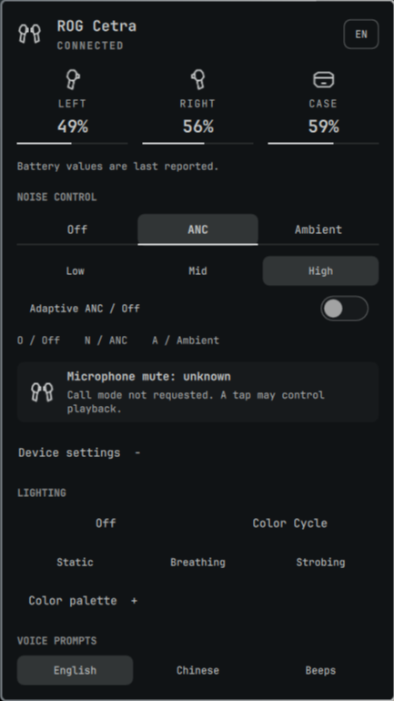

# ROG Cetra Control for Omarchy

Battery status, noise control, Aura lighting and headset voice-prompt settings
for ASUS ROG Cetra True Wireless SpeedNova over its USB receiver (`0b05:1ad3`,
interface 3). Bluetooth support observes audio connection,
routes, per-earbud/case charge and ANC mode. Hardware controls still require USB; other
Cetra models are not supported.



Sound panel rendered from the current QML and Omarchy theme in an isolated Qt
view. Battery values are illustrative; this is not a live device capture.

Version 1.9.0 combines the panel and icon rework, inline color editor and read-only
Bluetooth telemetry. See [release notes](../RELEASE-NOTES-1.9.0.md),
[SDD-BLUETOOTH-TELEMETRY.md](../SDD-BLUETOOTH-TELEMETRY.md) for vendor reads and
[BACKLOG.md](../BACKLOG.md) for acceptance limits.

## Install

Plugins run unsandboxed with your user permissions inside the existing Omarchy
shell. This plugin uses a native receiver helper and persistent local diagnostics.
Review [Security and privacy](#security-and-privacy) before installing.

Runtime dependencies: Omarchy Quattro/Quickshell, `hidapi` (hidraw backend),
`libpulse`, `bluez-libs` (libbluetooth) and Quickshell's PipeWire and Bluetooth services (tested on Quickshell
0.3.1). A PulseAudio-compatible audio server
is needed for peak capture. Setup additionally uses `bash`, `jq` and GNU `timeout`.
Building needs a C compiler and `pkg-config`.
The manual setup script can install `base-devel`, `hidapi`, `libpulse`, `bluez-libs` and `pkgconf`; it
does not install every runtime or test dependency.

```bash
omarchy plugin add https://github.com/PavelLizunov/omarchy-rog-cetra-control.git --yes
~/.config/omarchy/plugins/io.github.pavellizunov.rog-cetra-control/setup
omarchy plugin enable io.github.pavellizunov.rog-cetra-control --section right
```

The Marketplace clones source; it does not execute setup automatically. Setup
compiles all four helpers, runs their offline selftests and validates the folder.
It requires an explicitly unlocked Omarchy session; locked, unavailable or
malformed lock-status responses prevent binary replacement.

## Use

Click the bar icon to open the panel. Right-click or use the wheel to cycle noise
modes over USB. Each earbud silhouette fills from the bottom to show its own
last-reported charge. Hover or open the panel for exact percentages. An empty
outline means 0%; an internal dot marks unavailable charge. When an earbud is
reported present but its charge is unknown, its dim body remains visible without
a battery fill. The previous
`showPercentage` preference is ignored; saved settings do not need editing.
The optional upright microphone capsule stays to the right, in the same fixed
slot. Its signal changes without moving the earbud icons. A dim, complete outline
means no signal data; a bright empty outline means measured silence. Only measured
amplitude fills the capsule from the bottom. Neither state indicates native mute.

The panel opens on **Sound**: charge, noise control and microphone signal.
The compact **文 EN/RU** button in the header opens language selection in the
content area. The header and page tabs stay in place. Device has compact Settings / Color tabs.
**Device → Settings** contains connection details, the signal-meter
preference and voice prompts. **Device → Color** contains lighting controls.
Changing tabs does not send a headset command.
Microphone explanations are under **Device → Settings → Details**. The panel
requests a 380 × 560 frame at the default font scale and fits it to the available
screen. Tabs, editors, language selection and errors share that frame; only the
content scrolls. The sub-tab row and scrollbar gutter keep their space on short
pages. Keyboard focus reveals controls in the content viewport; focusing the
header does not move it. Lighting uses a circular selected-color preview.

- **Noise control:** Off, ANC and Ambient. In ANC, select Low/Mid/High or Adaptive.
  A manual level requests Adaptive Off when its current state is On or Unknown.
- **Battery:** percentages are last-reported values. Missing data is not proof of
  case placement. Bluetooth route and charging explanations are under **Device → Settings → Details**.
  A present earbud with missing battery reports stays visibly available with
  "Available; battery unknown". Its percentage is not copied from the other earbud
  or replaced with an old log value.
- **Voice prompts:** English, Chinese or Beeps; these are headset settings,
  separate from the interface language.
- **Keyboard:** Tab/Shift+Tab traverse controls, arrows move focus, Enter/Space
  activate. Escape first closes the color editor or language chooser, returning
  focus to its opener; otherwise it closes the panel. O/N/A select noise mode;
  1/2/3 select ANC level.
  Russian-layout equivalents are supported for O/N/A. Wheel arrows edit hue/saturation; sliders adjust brightness or RGB;
  Enter focuses Apply color.

Controls require receiver/earbud availability. Once presence has been observed,
stale battery values cannot re-enable controls. Pending settings wait up to 48
250 ms scheduler ticks (nominally 12 seconds), allowing the periodic ten-second
readback cycle. A late matching reply clears the error without repeating a write.
The selected state is readback, not an optimistic click result.

### Bluetooth status

The Sound tab shows battery, transport in the header, last-reported notice,
read-only Bluetooth ANC and Refresh. Connection routes, profile/LE explanations, system Battery1,
case freshness and Bluetooth microphone details are under **Device → Settings → Details**, collapsed
by default. USB availability collapses this section and restores USB controls.
A Select Bluetooth earbuds button opens Device when an audio identity needs selection.
The bar tooltip has three lines: device, connection status and last-reported charge.

Connect the earbuds using the system Bluetooth panel, then open **Device → Settings → Details** in this plugin and select the Cetra audio record. Select the main audio record, not `LE-ROG`. The picker lists devices with an observed Bluetooth audio endpoint;
it only saves an address to identify future observations. It does not connect,
pair, scan, or change audio profiles. No name-based automatic selection is used.

- The panel stays available after USB removal while the selected audio device
  remains connected. ANC controls, lighting, voice settings and the signal meter require
  USB. Microphone mute remains unknown on both transports.
- With USB earbuds available, their readings have priority. Otherwise the three
  battery columns and bar earbud fills use one complete vendor Bluetooth report.
  Unknown fields stay unknown: a right earbud inside a closed case may stop
  reporting its percentage while the left and case still report values.
- Bluetooth ANC is read-only. The plugin reads the verified `Asus_APP` service
  using three fixed getters; it does not send Bluetooth control commands.
- A successful read schedules the next one after 15 seconds with a panel open,
  or two minutes in the background. A failed transaction clears the report and
  retries automatically after 30, 60, 120, 240, then 300 seconds between attempts.
  Success resets this delay. **Refresh** allows an earlier attempt after a
  30-second cooldown; opening the panel does not reset the retry timer. A new
  connection permits another initial attempt. Reports expire after three
  minutes. Case charge/charging flags are last reported, not proof of fresh
  physical measurements. This cadence has not been measured for battery impact.
  BlueZ may retain a connected flag after the audio endpoint disappears: the
  header then stays connected while missing telemetry clears and retries.
- The separate **Bluetooth reported charge** is the system Battery1 property;
  its side and freshness are unknown. It never fills a missing vendor field or
  drives the bar. LE values are also excluded. Two system Bluetooth entries can
  share a name while showing different percentages. Select the audio entry; the
  plugin lists it once an audio endpoint is present.
- Service BLE cannot yet be associated with a physical case/headset reliably.
  Its battery value, including the observed stuck 71%, is not used.
- Playback and capture labels follow active PipeWire links, including processing
  paths. A default or connected device alone is not an active route. Mixed and
  unresolved routes are shown explicitly. These are system-wide application
  routes; capture includes other applications even if they do not qualify as calls.
- A2DP has no microphone in that profile. A headset profile shows a microphone
  only when its endpoint is observed. This version does not switch profiles or
  meter Bluetooth input; use system audio settings for profile selection.

`bluetoothAudioAddress` stores the chosen identity in the existing inline plugin
entry. Clear it using the picker to remove the association. Optional
`hideWhenDisconnected` takes precedence over the legacy `hideWhenReceiverMissing`;
when unset, the legacy value is preserved (default true). Connected audio candidates
keep the picker accessible when an identity needs selection. No implicit LE pairing
or pairing between different physical headsets is performed.

### Lighting

Open **Device → Color** and click the colored circle to open the visual palette.
Choose a color inside the circle and adjust brightness below it. A separate round
swatch beside the wheel previews the selected color and its HEX code. Click
**Apply color** once to save the channels, switch to manual color and send the
color to the earbuds. **Cancel** discards the draft. **Exact color** offers HEX
input and RGB sliders. Invalid HEX keeps the previous draft and blocks Apply
until corrected or another control is used. The Color tab explains the USB
requirement when only Bluetooth is available.

- Using the palette changes only a local draft. Cancel, leaving Color, closing the
  panel or losing USB discards it. Theme changes do not overwrite the draft.
- Effects and theme controls are hidden while editing. Theme selection saves
  preferences only; its separate Apply button is available outside the editor.
- Failed saves send nothing. If saving succeeds but dispatch fails, the editor
  stays open for retry and explicitly reports that the color was saved but not
  sent. **Close** leaves the saved preference in place; it does not undo Apply.
- Apply retains Static/Breathing/Strobing; from Off/Cycle/Unknown it selects Static.
- **Update with theme changes** is separate and defaults Off. With it enabled,
  explicitly apply a colored effect once per helper/connection session. Subsequent
  accent changes are coalesced for 350 ms and sent by the shared service.
- Enabling auto-theme explicitly reapplies an existing colored effect. Off and
  Cycle are never replaced automatically; identical payloads are deduplicated.
- Helper/receiver reset disarms automatic theme updates. Saved permission alone
  sends nothing at startup; apply a colored effect again to resume.
- The native owner may replay its last successful explicit preference on reconnect
  within the same owner session. Restart forgets that preference.

The preview is your selection. “Last sent” means a complete helper transmission,
not physical color readback. A partial USB write can change a zone even if the
transaction fails. The official Off/duplicate-commit sequence still needs capture
verification; the implemented sequence is recorded in RESEARCH.md.

### Microphone and calls

**Native microphone mute is unknown to the plugin.** Follow the headset voice
prompt. The plugin does not decode it, record PCM, infer mute from tap parity or
offer synthetic software mute as a native hardware control.

### Optional microphone signal meter

Enable **Show microphone level** under Device → Settings to add a compact meter beside
the bar icon. It measures the physical Cetra input, not the default mic or audio
after application processing. Movement means signal is present; zero is not proof
of native mute. The Sound tab distinguishes no active recording, unavailable route, waiting for
data and measured silence. None of these states reports native mute.

The feature defaults Off and uses `bin/cetra-peak`, built by setup with `libpulse`.
One service-owned monitor is loaded only while enabled and earbuds are available.
Peak capture starts immediately when an external endpoint has a verified active audio
path from Cetra. Processing clients, monitors and keepalives alone do not count.
Its own link cannot keep it alive or count as a call. Ordinary recording can show
a level without requesting call context. Voxtype and speech-recognition capture also
show a level while their Cetra input path is active, but never request call context.
Mixed or incomplete routes fail closed.
The helper pins its own stream to Cetra using Pulse and WirePlumber properties;
no EasyEffects exclusion or application-route change is required on the tested
PipeWire 1.6.8/WirePlumber host. Source mismatch stops capture; unavailable sources
or helper failures show no data and retry every two seconds while input is in use.

The audio server computes peaks; the helper receives only 20 mono peaks/second.
No audio or level samples are saved or sent over the network. This creates an additional PipeWire capture stream,
removed when external use ends, the option is disabled or the service unloads.
The helper publishes at most 20 updates/second. The cube-root visual scale is not dB SPL,
speech recognition, application audibility or hardware mute readback.

PipeWire topology events drive automatic call-context requests. Lost or unknown
capture is confirmed by a bounded two-second settlement timer. Explicit phone /
communication roles take precedence; untagged known communication applications
use a name fallback. An untagged generic browser capture does not prove a call.
The JSON `call_context` value is a requested context, not confirmed tap assignment.

**Continuous background microphone capture can prevent native Play/Pause taps.**
A controlled trial on this host reproduced the failure with a Voxtype keepalive
capturing through EasyEffects, recovery when capture stopped, and recurrence
when it resumed. The Cetra meter was absent and `call_context` was false. Vendor
tap reports alone do not prove that a media key was delivered. The plugin does
not change other applications or synthesize Play/Pause from those reports.
See the dated evidence in [RESEARCH.md](../RESEARCH.md).

The manual Request call mode control and M/Ь shortcut were removed because their
benefit outside a real call was unverified. Legacy `alwaysCallContext` is ignored.
The proximity/auto-pause control and P/З were also removed: enabling its sensor
setting did not establish PC playback pause over USB. Neither removal changes the
headset's existing proximity setting. Research commands remain in daemon IPC.

User trials found effective mute could be lost across left-earbud availability
changes without another tap. Read the dated [protocol research](../RESEARCH.md)
before relying on behavior across case transitions. These are observations, not
a firmware guarantee or absolute mute readback.

## Interface language and preferences

Use the language button in the header: System, English, Russian, German, French,
Spanish, Italian, Portuguese, Simplified Chinese, Japanese or Korean. System is
the default. Manifest settings labels remain English. All catalog keys and
placeholders are checked; fluent-human review of every locale remains pending.

Fallback is exact locale → compatible base → English → source text. Traditional
Chinese requests use `zh-Hant`/English rather than the Simplified `zh` catalog.
An explicit script takes precedence over region. See [locales/README.md](../locales/README.md).

UI preferences live in the plugin's inline entry in `~/.config/omarchy/shell.json`.
Writes use the scoped Omarchy API. `CetraPreferences.qml` reads the saved entry
through the bounded `cetra-status --read-settings` helper because host snapshots
and widget injections can be stale. FileView only watches changes (`preload: false`)
and does not read the document. Reads are coalesced for 100 ms, limited to one
process, capped at 1 MiB before output, and bounded to three seconds. Missing,
non-regular, oversized or detected concurrently modified files are rejected.
Accepted writes override older completions until readback or a three-second
reload; malformed reads preserve last valid state.

**Disabling/re-enabling can reset inline preferences in the tested Omarchy host.**
Back up your plugin entry before doing so. Ordinary popup close/reopen does not
disable the plugin. The plugin does not maintain a second hidden settings file.

## Update and remove

```bash
omarchy plugin update io.github.pavellizunov.rog-cetra-control
~/.config/omarchy/plugins/io.github.pavellizunov.rog-cetra-control/setup
```

After updates, verify an actual visible change. The tested host sometimes kept
old QML despite reload logs. If needed, restart the shell when unlocked and when
interruption of shell services is acceptable. Never launch a second Quickshell
instance for this plugin.

```bash
omarchy plugin disable io.github.pavellizunov.rog-cetra-control
omarchy plugin remove io.github.pavellizunov.rog-cetra-control
```

There is no system service. Generated helpers are removed with the folder; logs
remain. After the owner has stopped, remove the log and `.old` backup described
below if you want to delete diagnostics.

## Security and privacy

- One long-running owner opens receiver interface 3. Other clients use the
  private UNIX socket, not a competing hidraw reader.
- Runtime makes no Internet requests. The Bluetooth reader connects to the
  selected device through local SDP/RFCOMM sockets. Repository/package installation
  and updates use the Internet. Setup does not download or execute Windows tools.
- The helper sends the documented read queries and explicit control reports.
  Call requests and valid session lighting replay can occur automatically; see
  [HANDBOOK.md](../HANDBOOK.md) for cadence and [RESEARCH.md](../RESEARCH.md) for opcodes.
- USB settings and presence/charging expire after 30 seconds. USB battery/mode freshness
  flags also expire after 30 seconds; the UI hides stale values. Raw daemon battery
  and mode fields remain last-reported values for diagnostic compatibility.
- Runtime socket/lock/cache require an owner-private `$XDG_RUNTIME_DIR`. Missing,
  relative or shared roots are rejected; there is no shared `/tmp` fallback.
  Cache replacement uses a private unique temporary file and rename.
- IPC validates command domains and framing. Owner sends handle partial writes,
  disconnecting clients on backpressure. Owner stdout retains at most a partial
  frame and the latest pending state; mirror queues are bounded to 4 KiB per direction.
- Call detection reads PipeWire metadata, not audio samples. The optional meter
  creates a peak-capture stream as described above. The selected Bluetooth address is persisted in the plugin entry; native
  USB device serial numbers are not persisted. No system microphone mute or existing audio routing is changed.
- Bluetooth telemetry adds no capture stream. The native reader opens the selected
  device’s SDP/RFCOMM service and sends only three verified getters, without root.
  It does not pair, scan, change profiles or send control writes. At most 16
  connection/profile/route diagnostic snapshots are kept in service memory, without
  addresses or battery sampling. They reset with the service and honor
  `CETRA_DIAGNOSTICS=0`; they do not write to the USB owner log.
- Owner-only telemetry logs commands/RGB, gestures, battery/settings, lifecycle,
  timestamps and raw unhandled HID bytes. This can reveal usage timing.
- Log path: `${XDG_STATE_HOME:-$HOME/.local/state}/omarchy/rog-cetra-control.log`.
  If unsafe/unavailable, a verified private runtime directory is tried. Files are
  no-follow, owner/type/single-link checked and mode 0600. Ancestors are checked
  for links, ownership and writable paths; this is not a descriptor-relative
  guarantee against concurrent same-user directory replacement.
- Above 5 MiB the log rotates to one `.old` backup. Set `CETRA_DIAGNOSTICS=0` in
  the environment inherited by the shell before starting it to disable new
  diagnostic writes (existing files remain). Logging/cache I/O is synchronous;
  a stalled filesystem can still delay the owner. Shared-shell teardown remains best effort for hung
  descendants; one passing normal exit does not cover every reload race.

## Development and verification

[DEVELOPMENT.md](../DEVELOPMENT.md) covers hardware safety and verification rules.
Directory notes: [tests](../tests/DEVELOPMENT.md), [assets](../assets/DEVELOPMENT.md),
[helpers](../bin/DEVELOPMENT.md).
[MODULES.md](../MODULES.md) maps changes to source owners and tests.
[HANDBOOK.md](../HANDBOOK.md) describes architecture; [CONTRIBUTING.md](../CONTRIBUTING.md)
contains contribution rules. Historical records are not current runtime specs.

```bash
./tests/run.sh
omarchy plugin validate .
git diff --check
```

Tests additionally require Python 3, Node.js, a C++ compiler, Qt6Quick/Qt6Qml/Qt6Gui
development libraries and the installed Omarchy shell sources. Some suites still
require `/tmp/opencode` to exist; this is temporary-path debt, not an OpenCode
installation requirement. Tests compile in isolation and never open real HID.
Offline suites and actual Qt checks do not replace live hardware/UI acceptance.

For offline JSON output from the already-built fixture helper:

```bash
CETRA_STATUS_FIXTURE='{"status":"ok","receiver":false,"microphone_state":"unknown"}' ./bin/cetra-status
```

This prints JSON; it does not preview the UI or inject fixtures into a running shell.

## Compatibility and license

Only the SpeedNova USB receiver listed above has been tested. Versions through
1.2.1 used `io.github.pavellizunov.rog-cetra-battery`; remove that old plugin before
installing the renamed one. ROG, Cetra, SpeedNova and ASUS are ASUSTeK trademarks.
This community project is not affiliated with ASUS. Source is MIT; see [LICENSE](../LICENSE).
